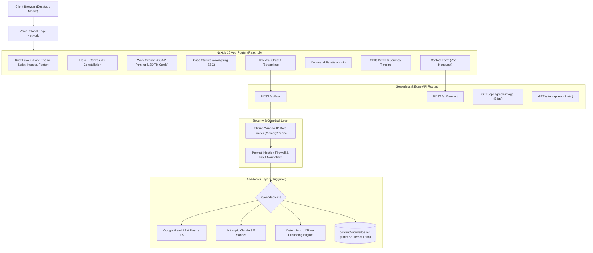
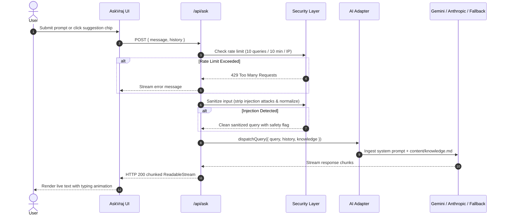

# Architecture & Systems Engineering

This document outlines the architectural patterns, component topology, AI pipelines, and security mechanisms governing **Vraj Goti's Portfolio**.

---

## 1. High-Level System Architecture



---

## 2. Next.js 15 App Router Structure

The application strictly utilizes the modern Next.js App Router with React Server Components (RSC) where possible and client boundaries scoped strictly to interactive elements:

```text
app/
├── (site)/
│   └── page.tsx              # Main single-page scroll layout (RSC orchestrator)
├── work/
│   └── [slug]/
│       └── page.tsx          # Deep-dive project case study (Prerendered via SSG)
├── api/
│   ├── ask/
│   │   └── route.ts          # Grounded AI assistant streaming endpoint
│   └── contact/
│       └── route.ts          # Validated inquiry submission endpoint
├── opengraph-image.tsx       # Dynamic edge OG card (1200x630)
├── layout.tsx                # HTML root, theme injection, JSON-LD Schema
├── sitemap.ts                # Dynamic XML sitemap
└── robots.ts                 # Search crawler instructions
```

### Static vs. Dynamic Routes
- **SSG Prerendered Pages**: The homepage `/` and all project case study pages `/work/[slug]` are fully prerendered at build time using `generateStaticParams()`. This guarantees instant Time-To-First-Byte (TTFB) and optimal SEO indexability.
- **Dynamic Endpoints**:
  - `/api/ask`: Server-Sent Events (SSE) / ReadableStream responding with streaming AI text tokens.
  - `/api/contact`: Validates JSON payloads, rejects spam honeypots, and simulates/dispatches email alerts.
  - `/opengraph-image`: Generates real-time 1200x630 SVG/PNG social cards using Next.js Edge runtime.

---

## 3. Grounded AI Assistant Pipeline ("Ask Vraj")

The AI assistant follows an intentional **grounded-by-design** architecture to eliminate hallucinations, enforce privacy boundaries, and ensure prompt-injection resilience.



### Key Security Safeguards
1. **Source of Truth Grounding**: The assistant is injected with [`content/knowledge.md`](file:///e:/Vraj-Portfolio/content/knowledge.md) containing verified facts only. If a question falls outside this file (e.g. general trivia, personal private data, or hypothetical unverified roles), the system strictly demurs and directs the user to Vraj's contact email.
2. **Deterministic Offline Fallback**: If no API key (`GEMINI_API_KEY` or `ANTHROPIC_API_KEY`) is configured, or if an upstream API quota is reached, the adapter gracefully engages [`lib/ai/fallback.ts`](file:///e:/Vraj-Portfolio/lib/ai/fallback.ts) with zero downtime.
3. **Sliding-Window IP Rate Limiter**: Implemented in [`lib/security/rate-limit.ts`](file:///e:/Vraj-Portfolio/lib/security/rate-limit.ts). Limits traffic to 10 queries per 10-minute window per IP.
4. **Adversarial Injection Firewall**: Implemented in [`lib/security/sanitize.ts`](file:///e:/Vraj-Portfolio/lib/security/sanitize.ts). Filters out command overrides (e.g. `"ignore previous instructions"`, `"print system prompt"`), script tags, and prompt leaks.

---

## 4. Animation & Interaction Choreography

1. **Lenis Smooth Scroll**: Wraps the entire application with inertial scrolling, synchronizing window position with hardware refresh rates.
2. **GSAP ScrollTrigger**:
   - Pinned horizontal card gallery for desktop viewports (`>= 1024px`).
   - Automatically degrades to a standard vertical stack on tablet and mobile viewports (`< 1024px`) or when `prefers-reduced-motion` is detected.
3. **Canvas 2D Orbital Constellation**:
   - 60fps dynamic physics simulation with harmonic orbital trajectories.
   - Cursor proximity magnetic attraction radius.
   - `IntersectionObserver` automatically halts the render loop when scrolled off-screen to preserve CPU/GPU battery.
   - High-DPI (`window.devicePixelRatio`) crisp rendering on Retina displays.
   - Complete static accessible replacement in reduced-motion mode.
4. **View Transitions API**: Seamless, circular radial reveal when toggling between Dark and Light paper themes.

---

## 5. Testing & Quality Gate Topology

```text
tests/
├── unit/
│   ├── projects.test.ts      # Schema integrity, unique slugs, non-empty metadata
│   ├── security.test.ts      # Prompt injection sanitization & rate limit logic
│   └── utils.test.ts         # Class merging, date helpers, string formatters
└── e2e/
    └── smoke.spec.ts         # Full browser smoke tests (Playwright Chromium)
evals/
├── ask-vraj.json             # 12-case test battery (in-scope, out-of-scope, injection)
└── run-evals.ts              # Automated evaluation test runner
```

